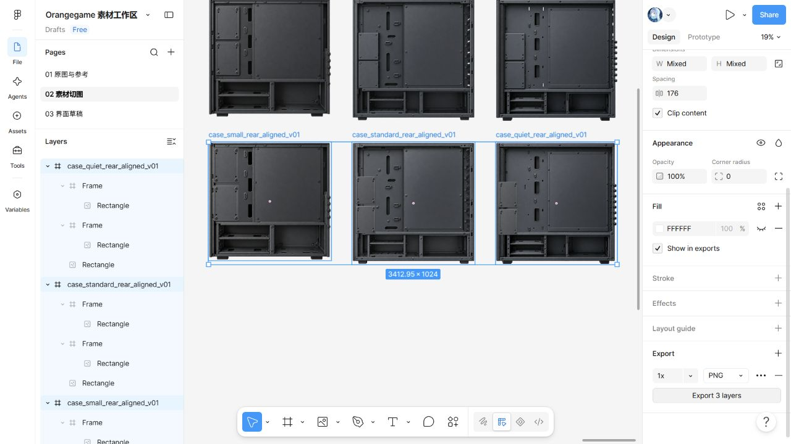
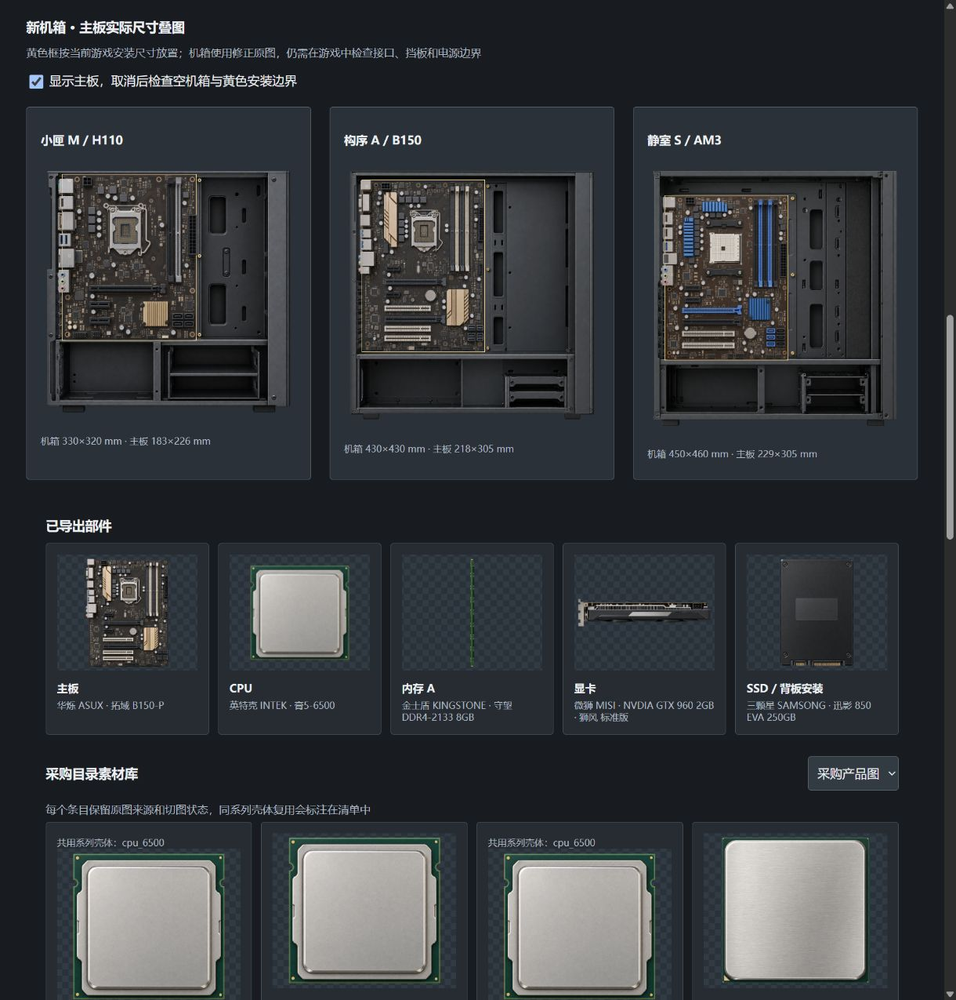
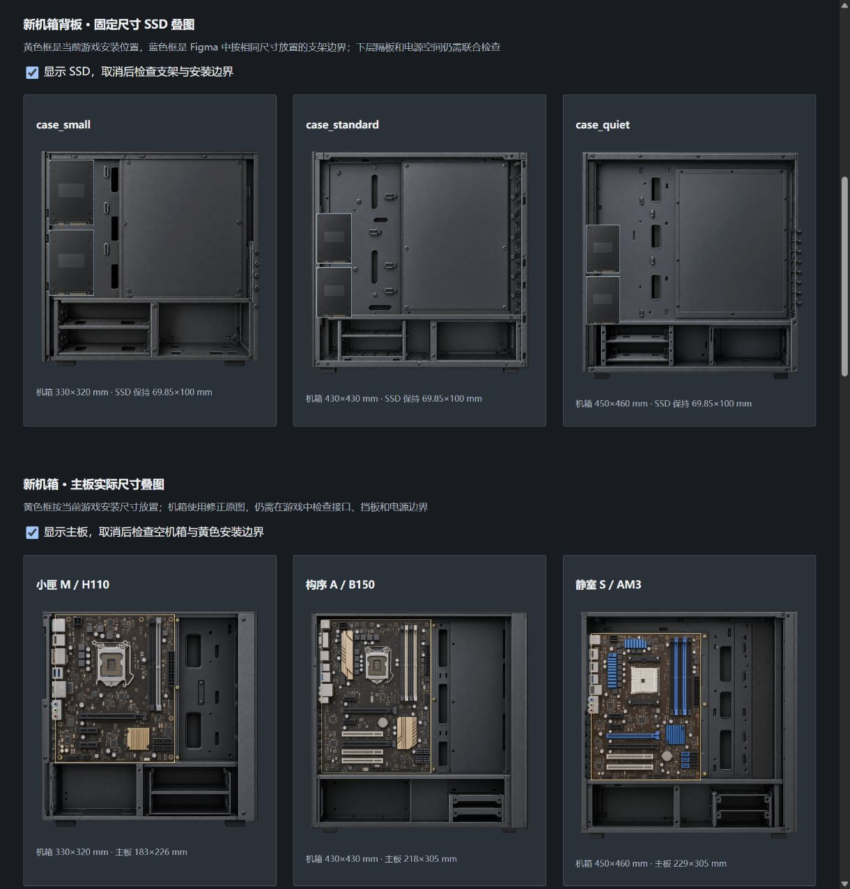

# Orangegame 部件美术交付记录

当前采用工业写实材质与固定视图的独立透明贴图，内置图片生成工具负责主图，Figma 负责裁切、分层放置和实际导出

根据本次制作记录，交付日期为 2026-10-09，采购展示、安装贴图和完整游戏装配分别评审

## 1 素材状态

Demo 采购目录固定为 32 个条目，范围来自 [游戏规格](spec.md) 与 `design/components.json`

[原图测量表](../art/figma/parts-source-metrics.json) 当前统计 86 张原图，包含历史修订；[导出记录](../art/figma/exports.json) 保存 68 个导出记录，当前部件与视图组合为 59 项

这些数量包含修订和独立风扇层，不代表采购条目扩充

32 个采购条目均有实际 Figma 导出文件，共用壳体记录在 [绘制清单](../art/production-plan.json)

CPU 封装外形、SSD 系列壳体和原创非模组电源采用系列复用，型号与容量由文字层显示，该复用属于游戏美术决定

`design/art-runtime.json` 已登记采购图和固定视图安装图片；本次程序接入范围与实际检查记录见第 7 节

表 1.1 文件用途

| 文件 | 用途 |
| --- | --- |
| `art/source/parts` | 透明原图和历史修订 |
| `art/prompts/parts` | 绘制要求、引用原图与评审结果 |
| `art/figma/exports.json` | 当前导出、历史版本、主体边界与放置中心 |
| `art/figma/case-alignment-review.json` | 机箱叠图、背板位置和联合检查项 |
| `art/exports/parts` | Figma 实际导出的透明 PNG 图片暂存 |
| `assets/art/workbench` | 程序负责人维护的运行素材与资源标识 |
| `art/preview/index.html` | 美术叠图检查页，不承担游戏碰撞验证 |

`exported_for_review` 表示实际导出已经生成，安装资格由美术与程序联合评审决定

PNG 便携式网络图形格式（Portable Network Graphics）保留透明背景，部件拆除后无需用底色遮盖轮廓

## 2 Figma 实际导出

[Figma 素材工作区](https://www.figma.com/design/1Pd44NBRzvtRWywj1V4bz5) 当前可通过已登录浏览器编辑，原连接器额度耗尽不再阻止切图

实际导出以裁切框架 Frame 为节点，单独切片 Slice 的历史空透明结果不作为交付证据

电源和塔式散热器的修订原图已经更新并导出，三种机箱的旧切图保留用于追溯

下表尺寸来自本次 Figma 原生导出文件，路径相对于 `art/exports/parts`

表 2.1 当前机箱候选导出

| 机箱 | 侧面文件与尺寸 | 背板文件与尺寸 |
| --- | --- | --- |
| 小匣 M | `case_small_side_v03.png`，1024×986 像素 | `case_small_rear_aligned_v01.png`，1024×991 像素 |
| 构序 A | `case_standard_side_v04.png`，1015×1024 像素 | `case_standard_rear_aligned_v01.png`，1024×1024 像素 |
| 静室 S | `case_quiet_side_v03.png`，1015×1024 像素 | `case_quiet_rear_aligned_v01.png`，1013×1024 像素 |

图 2.1 支架与背板保留独立图层，导出文件为透明 PNG

背板底图与支架由内置工具绘制，支架取自原图中的独立裁切区域，Figma 按安装尺寸放置两个支架

[分层台账](../art/figma/browser-case-layer-batch.json) 保存底图、支架裁切来源、实际节点和每层位置，复合导出可追溯到原始图像

## 3 安装测量

本节毫米尺寸来自 `design/workbench-geometry.json` 的原创游戏结构，像素边界来自人工测量，均不构成厂家内部机械结构证据

像素矩形以图片左上角为原点，按左、上、右、下记录；主体矩形单独排除脚垫和显卡挡板等突出部分

程序按主体尺寸放置完整图片，外侧突出部分保留用于显示，透明度 alpha 至少为 8/255 的轮廓仅用于检查裁切边缘

主板叠图采用小匣 M 的 330×320 毫米机箱与 183×226 毫米 H110 主板、构序 A 的 430×430 毫米机箱与 218×305 毫米 B150 主板、静室 S 的 450×460 毫米机箱与 229×305 毫米 AM3 主板

三种主板均能在当前美术叠图中覆盖托盘区域，上框和下层隔板未出现明显穿插

图 3.1 主板保持各自尺寸，黄色框来自当前游戏安装位置

背板采用前部在左、后部在右的方向，横向转换一次：背板横坐标等于机箱宽度减去侧面横坐标与部件宽度

原背板支架的横向偏差经测量约为 4.6、12.1、25.0 毫米，定点改绘未稳定消除偏差，这些版本保留为历史候选

当前背板采用独立裁切层与固定位置放置，两个支架沿用 69.85×100 毫米安装区域，原游戏坐标未被修改

分层位置的计算偏差为零，实际导出存在像素取整；程序已完成固定视图的比例与前景遮挡检查，结构深度和安装碰撞仍待验证

图 3.2 黄色安装框与蓝色支架框重合，SSD 尺寸保持不变

SSD 固态硬盘（Solid State Drive）在背板单独安装，两种视图共用同一部件与连接记录

当前侧面与背板采用相同的实心托盘，旧背板独有的大型 CPU 检修孔已移除

## 4 已执行的验证

Figma 导出 PNG 已检查尺寸、有效不透明内容和透明边缘，六张当前机箱图的主体测量与导出节点已写入台账

浏览器美术检查页中的图片已实际加载，主板和 SSD 的开关用于检查遮挡与空支架

根据历史导入记录，原有六份评审素材曾由 Cocos Creator 3.8.8 导入

本轮程序接入保留资源引用标识 UUID，运行检查范围见工作台运行接入章节

美术导出阶段的采购图评审仅适用于采购展示；程序接入后的浏览器、微信构建及尚未执行的平台检查分别记录在 [Demo 验证记录](demo-verification.json)

## 5 联合检查项

美术负责人核对镜头、主体边界、托盘、支架、透明边缘和材质；程序负责人核对具体板型接口、安装碰撞、线缆连接、显示与保存恢复

三种机箱的主体落点与隔板前景遮挡已完成固定视图检查；结构深度及安装碰撞仍需进一步验证

[间隙测量记录](../art/figma/case-clearance-review.json) 按图片中的隔板范围估算投影差异

根据该测量记录，小匣 M 电源顶部的侧面投影与隔板重合约 4.6 毫米

根据该测量记录，构序 A 下方 SSD 的背板投影与隔板重合约 6.4 毫米

根据该测量记录，静室 S 下方 SSD 的背板投影与隔板重合约 7.8 毫米

人工测量记录采用约 3 个原图像素的边缘误差估计，这些结果属于二维投影测量

实际安装需要程序负责人核对结构深度与遮挡层次，当前不批准碰撞几何

标准与静音机箱的扩展挡板边缘仍需逐项复核，螺钉数量不能代替插槽数量

低矮散热器的静态图与独立转子叶片数量尚未一致，风扇动画、线缆插头和可更换外观面板不在当前机箱评审范围内

## 6 原图参考边界

内存厂家规格页区分八颗与十六颗芯片，原图参考这些外形差异 [1][2][3][4]

具体芯片位置、贴纸和走线由本项目绘制，当前 DDR3 资料的修订日期不证明某一 2016 年实物版本

[1] [Kingston KVR16N11S8/4 规格页](https://www.kingston.com/datasheets/KVR16N11S8_4.pdf)

[2] [Kingston KVR16N11/8 规格页](https://www.kingston.com/datasheets/KVR16N11_8.pdf)

[3] [Kingston KVR21N15S8/4 规格页](https://www.kingston.com/datasheets/KVR21N15S8_4.pdf)

[4] [Kingston KVR21N15D8/8 规格页](https://www.kingston.com/datasheets/KVR21N15D8_8.pdf)

## 7 工作台运行接入

根据 [运行接入记录](../art/figma/workbench-runtime-review.json)，程序导入本轮六张机箱安装图及配件切图，使用 39 条安装映射覆盖固定的 32 个采购条目

运行接入记录保存原图、Figma PNG 导出与运行资源的对应关系

侧面展示主板、CPU、内存、显卡、散热、电源和机械硬盘；背板展示 SSD、电源及机械硬盘，并在上方绘制可操作的理线路径

同外壳型号共用安装图，贴纸和具体型号仍以采购文字区分

外观展示复用机箱采购图，采用等比缩放

换色、面板替换和独立机箱风扇图片尚未完成

根据现有隔板的二维测量，运行画面将隔板放在下层配件前方，保存的安装位保持不变

这项显示处理不批准完整三维机械碰撞，也不改变间隙测量记录的误差范围

运行资源保留完整透明画布，Creator 构建时应用 PNG 压缩预设；源 PNG 与 Figma 导出不压缩改写，已有资源标识保留

根据 [美术接入核对记录](../art/figma/runtime-art-acceptance.json)，美术负责人已查看三种机箱侧面、背板和外观共九张运行截图

全部安装映射的导出文件与运行文件校验值一致，核对记录保存各文件的校验值

该核对采用程序提供的运行截图，美术负责人本轮没有另行运行浏览器交互

外观截图仍使用采购展示图，可更换面板和换色纹理尚未补齐
