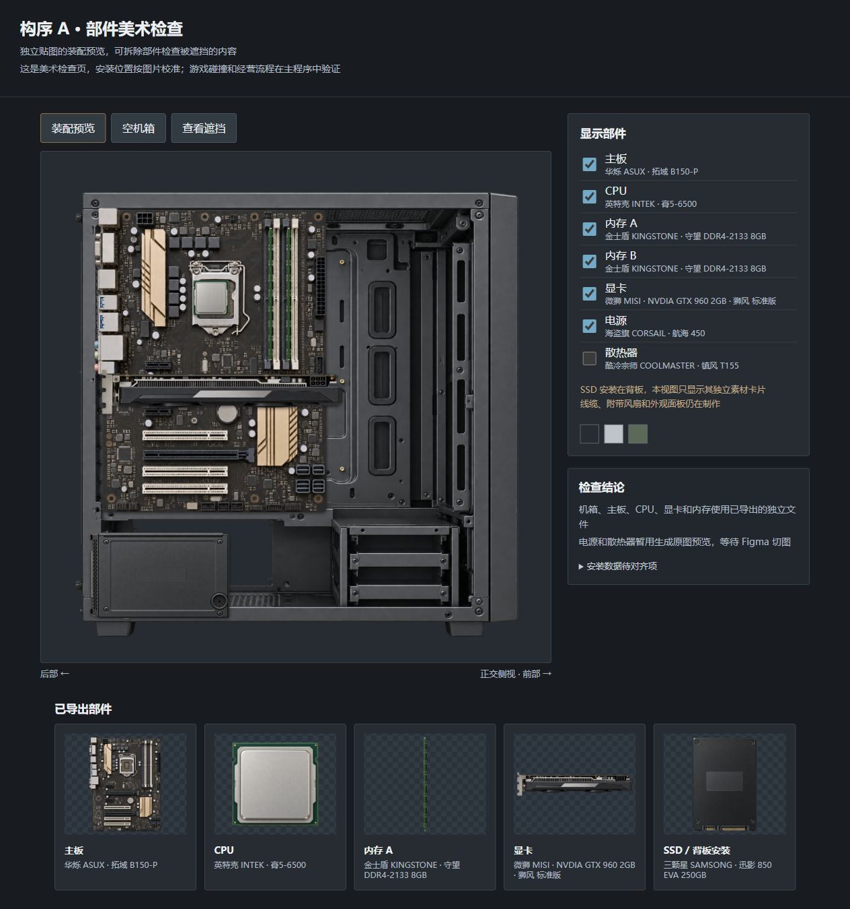

# Orangegame 部件美术交付记录

当前采用固定视图的独立透明贴图，在 Cocos 中按安装位置和遮挡关系组合

主素材由内置图片生成工具绘制，Figma 负责裁切边界、缩放和导出

主板、CPU、内存、显卡、电源和散热器分别保存，移除一件部件不会留下它的外壳或阴影

## 1 素材接入状态

Demo 固定目录包含 32 个采购条目，沿用 [游戏规格](spec.md) 与 `design/components.json`

[绘制清单](../art/production-plan.json) 按条目记录侧面安装、背板安装和采购视图，原图对应完整的提示词记录

同一游戏产品系列可以共用无印字的壳体，型号和容量由文字层显示

清单明确记录这种复用，CPU 的 LGA1151 外形、SSD 系列壳体和原创非模组电源采用该方式

该复用属于本项目的美术决定，不能据此认定不同实物型号的内部结构相同

表 1.1 素材文件与状态

| 文件 | 用途 | 状态含义 |
| --- | --- | --- |
| `art/source/parts` | 完整透明原图，保留各次修正 | 原图存在不表示已经通过结构评审 |
| `art/prompts/parts` | 每张图的绘制要求和来源 | 区分厂家参考、原创外壳和制作假设 |
| `art/production-plan.json` | 全部采购条目和视图进度 | 共用壳体、缺失视图和待修正项分别记录 |
| `art/figma/exports.json` | 已实际导出的接入信息 | 包含部件、视图、路径、轮廓、中心和资源标识 |
| `art/exports/parts` | Figma 实际导出的 PNG | 裁切与透明边缘检查的暂存文件 |
| `assets/art/workbench` | 已导入的评审导出 | 原有资源标识保持不变，显示资格由主程序接入表控制 |
| `art/preview/index.html` | 部件分层的美术检查页 | 用于查看透明边缘和移除部件，不验证游戏碰撞 |

`exported_for_review` 表示已完成 Figma 导出，仍需核对具体主板和机箱的安装位置

`reviewed` 或 `approved` 才能进入主程序的正式显示清单，美术负责人和程序负责人分别核对图像与安装数据

## 2 实际完成的切图

[现有 Figma 素材工作区](https://www.figma.com/design/1Pd44NBRzvtRWywj1V4bz5) 保留原图节点与切图节点

Figma 的裁切 Frame 能导出有效图像，单独 Slice 的连接器导出曾返回空透明图，因此记录中以 Frame 作为实际导出节点

表 2.1 已导出并导入引擎的评审素材

| 部件 | 视图 | 运行路径 | 当前状态 |
| --- | --- | --- | --- |
| 构序 A 机箱 | 侧面 | `assets/art/workbench/side/case_standard.png` | 已导出，待安装对齐评审 |
| 拓域 B150-P 主板 | 侧面 | `assets/art/workbench/side/mb_b150.png` | 已导出，待板型接口对齐 |
| 膏5-6500 CPU | 侧面 | `assets/art/workbench/side/cpu_6500.png` | 已导出，待插座位置对齐 |
| 狮风 GTX 960 显卡 | 侧面 | `assets/art/workbench/side/gpu_960.png` | 已导出，待插槽位置对齐 |
| 守望 DDR4-2133 8GB 内存 | 侧面 | `assets/art/workbench/side/ram_ddr4_8.png` | 已导出，待内存槽位置对齐 |
| 迅影 850 EVA 250GB SSD | 背板 | `assets/art/workbench/rear/ssd_250.png` | 已导出，待背板支架对齐 |

电源和塔式散热器在 Figma 中已有切图节点，原图修正后需要更新这些节点再导出

连接器的 Figma Starter 调用额度已用完，可用浏览器中的该文件目前处于访客状态，无法编辑和继续导出

该限制不影响独立原图绘制，也不影响记录后续裁切方案

## 3 安装位置差异

以下数值均为制作假设值，来自人工测量的图像位置和项目中的结构草案，不构成厂家内部结构或碰撞验证结果

像素坐标以图片左上角为原点，轮廓矩形记录左上位置、宽和高

贴图放置中心 `pivot` 采用引擎的归一化坐标，横向从左起算，纵向从下起算

透明边缘的有效轮廓按透明度 alpha 至少为 8/255 统计，部件的主体矩形单独记录

带挡板、脚垫或安装耳的部件不能直接用整个透明画布充当物理尺寸

B150 主板的主体候选范围为原图 `[67,97,1023,1388]`，CPU 插座中心约为 `[548,479]`

按主体宽 218 毫米、高 305 毫米放在托盘 `[20,110]` 后，插座中心约为 `[129.7,324.8]` 毫米

结构草案中的通用 CPU 中心为 `[109,259]` 毫米，两者存在偏差

内存槽和主 PCIe 插槽也需要针对该板型对齐，接入表保留了原图与导出图中的测量点

仅调整一张贴图的显示位置不能使接口、连线和碰撞检查共同对齐，需要板型适配或联合修正结构草案

机箱背板视图候选使用前部在左、后部在右的方向，与侧面安装视图相反

背板坐标需要转换横向投影，不能直接复用侧面图的横向位置

生成的塔式散热器顶盖、风扇边缘和机箱开孔仍需检查各自的投影，待评审候选不会被当作精确机械模型

本次没有改写 `design/workbench-geometry.json`，价格、供货、经营难度和其他数值由各自负责人维护

## 4 已执行的检查

六份 PNG 已由 Cocos Creator 3.8.8 实际导入，生成相邻资源标识文件和可供引擎显示的图片资源 SpriteFrame

替换类型和重新导入时保留了图片资源标识 UUID，基础浏览器构建成功

素材检查页已实际打开，所有图片加载完成，空机箱按钮能移除全部部件

拆除散热器后能够看到独立 CPU，检查页使用人工校准的显示位置

图 4.1 美术检查页的实际浏览器截图，散热器被移除以查看 CPU

以上记录验证了图片导入和检查页中的分层显示，完整游戏装配、微信构建、模拟器及真机需各自记录结果

## 5 原图参考边界

内存参考的厂家规格页区分了八颗与十六颗芯片，原图据此采用不同的单面或双面轮廓 [1][2][3][4]

具体芯片排布、贴纸位置和电路走线由本项目绘制，当前 DDR3 资料的修订日期不能证明某一 2016 年实物版本

[1] [Kingston KVR16N11S8/4 规格页](https://www.kingston.com/datasheets/KVR16N11S8_4.pdf)

[2] [Kingston KVR16N11/8 规格页](https://www.kingston.com/datasheets/KVR16N11_8.pdf)

[3] [Kingston KVR21N15S8/4 规格页](https://www.kingston.com/datasheets/KVR21N15S8_4.pdf)

[4] [Kingston KVR21N15D8/8 规格页](https://www.kingston.com/datasheets/KVR21N15D8_8.pdf)
