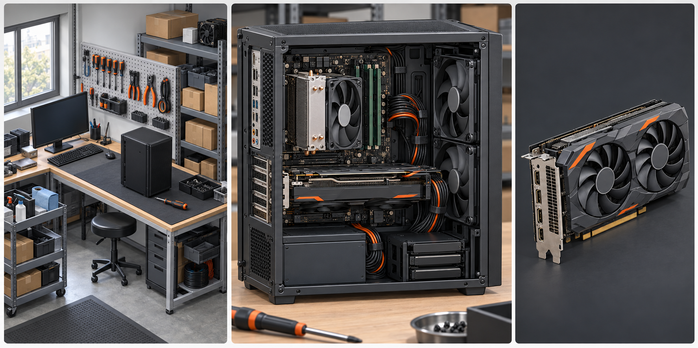

# Demo 详细设计候选

玩家已确认三档难度、普通难度允许合理经营盈利、点选或拖放装配、逐条连接和节点理线，画面现采用参考《装机模拟器》的相对写实方向

以下数值均为本轮游戏设计假设值，覆盖资金、费用、工时、销量、交互阈值和素材尺寸，供首版试玩验证

游戏币与现实货币没有换算关系，Demo 表示 2016 年 1—6 月的试玩版本

配件成本和既有样机配置采用现有配件库 [1]，固定玩法采用游戏规格 [2]

素材保存和切图采用项目约定 [3]，六个月结果由候选经营计算器生成 [4]

## 1 开局资源

三档难度通过现金、场地和人员产生差别，配件兼容、订单承诺和工作台辅助采用同一套规则，困难档仍能经营精品或量产

表 1.1 开局候选，数值由本轮设计提出

| 项目 | 简单 | 普通 | 困难 |
| --- | ---: | ---: | ---: |
| 现金，游戏币 | 45000 | 30000 | 1500 |
| 账期额度，游戏币 | 60000 | 30000 | 15000 |
| 开局可选路线 | 三条 | 三条 | 仅精品 |
| 雇员人数 | 1 | 1 | 1 |
| 装配台数量 | 2 | 1 | 1 |
| 测试台数量 | 1 | 1 | 1 |
| 月租金，游戏币 | 600 | 900 | 1100 |
| 月基础杂费，游戏币 | 150 | 400 | 700 |
| 月工资，游戏币 | 1400 | 1400 | 1400 |
| 每月固定支出，游戏币 | 2150 | 2700 | 3200 |
| 每月可用人工，模拟工时 | 208 | 208 | 208 |
| 采购条款系数 | 0.97 | 1.00 | 1.07 |
| 可承受亏损月数 | 8.0 | 2.1 | 1.2 |

三档开局均无配件库存，玩家自行选择第一套采购

老板每月提供 96 模拟工时，每名基础员工提供 112 模拟工时

每张装配台和测试台各提供 160 模拟工时

模拟工时表示当月可安排的工作量，玩家可以加速执行

界面同时显示人工、装配台和测试台的占用，增加桌子只增加设备容量，增加人员才增加可用人工

三档通过起始资金、账期额度、场地费用、采购条款和开局路线区分。三档雇员人数相同，因为员工产能经常用不满，"少一名员工"会变成纯省钱，让困难档反而更容易。困难档现金最少、账期额度最小、租金与杂费更高，采购条款还差 7%，因为新成立的小公司拿不到好价格

采购条款系数作用在配件成本上，简单档 0.97 表示老客户价格，困难档 1.07 表示新公司溢价，三档共用同一套渠道折扣，不额外增加系统

可承受亏损月数按「开局现金 ÷ 该难度可行路线的最差单月净现金流出」计算，三档结果为 8.0 / 2.1 / 1.2 个月，命中已确认目标

| 难度 | 精品 | 量产 | 混合 | 可承受亏损月数 |
| --- | ---: | ---: | ---: | ---: |
| 简单 | 34160 | 40393 | 46278 | 8.0 |
| 普通 | 29010 | 31120 | 37708 | 2.1 |
| 困难 | 12209 | 开局锁定 | 开局锁定 | 1.2 |

难度顺序由 `npm run check:difficulty` 守住。它对每一对相邻难度、每一条路线、每一个情景共 24 组做三项比较：利润、期末现金、破产与否，任何一项出现「更难的一档反而更好」就失败

| 难度 | 最差单月净流出 | 可承受亏损月数 | 破产组数 |
| --- | ---: | ---: | ---: |
| 简单 | −5654 | 8.0 | 0 |
| 普通 | −14441 | 2.1 | 1 |
| 困难 | −1220 | 1.2 | 3 |

困难档每月亏得最少（−1220），但开局现金只有 1500，所以最先撑不住；简单档每月亏得最多（−5654），但有 45000 现金兜底。**三档的区别来自现金厚度而不是单月盈亏幅度**，这正是把雇员人数拉平之后的设计方向

这条守卫是有来历的：困难档曾经在每一条路线上都比普通档更容易（困难 41610 对普通 32310），原因是员工产能经常用不满，「少一名员工」变成了纯省钱。修复方式是把三档雇员人数拉平，改用现金、场地费用和采购条款区分难度。此后这条性质由校验持续守住
破产矩阵（27 组）：简单档三个情景全部存活；普通档在客群下滑 35% 时量产于第 5 月破产；困难档在配件涨价 10% 时精品于第 2 月破产。简单档抗住全部压力，普通档怕需求下滑，困难档怕成本上涨

**困难档开局只能走精品**，量产与混合需要后续解锁。**方案已定**：累计交付 5 台高定后解锁，落在第 4 月末。待用户确认，见 [待定决策包](decisions.md) 决策 3。当前仿真器仍会计算这两条路线并标记为开局锁定，仅用于对照

困难档的目标不是现金缓冲本身，而是精品路线对玩家的要求更高：定金撑起启动资金，任何设计失误都会通过口碑和订单量放大成亏损

## 2 单台收益

售价减配件、耗材、包装和交付费用得到单台贡献，用于支付月固定支出和发展投入，工资仅在月固定支出中扣除一次

表 2.1 四套样机收益，配件和直接成本来自现有草案 [1]，售价由本轮设计提出

| 方案 | 配件 | 耗材 | 包装 | 交付 | 总直接成本 | 售价 | 单台贡献 |
| --- | ---: | ---: | ---: | ---: | ---: | ---: | ---: |
| 预算办公 | 1750 | 40 | 40 | 40 | 1870 | 2115 | 245 |
| 主流游戏 | 4040 | 60 | 60 | 60 | 4220 | 4566 | 346 |
| 静音办公高定 | 2560 | 180 | 90 | 80 | 2910 | 5100 | 2190 |
| 静音创作高定 | 6440 | 400 | 100 | 100 | 7040 | 11050 | 4010 |

表内四个售价均处于既有预算示例内，直接费用拆分为本轮候选，工具节约仅作用于耗材，包装和交付继续按原值记账

普通档当月交付 1 台静音创作高定和 1 台静音办公高定时，经营利润为 $2460+990-2150=1300$ 游戏币

普通档只销售预算办公机时，$5\times430=2150$ 游戏币恰好覆盖月固定支出，首次开发还有 120 游戏币试制费，因此第一月需要卖出至少 6 台才能盈利

高定预算在订单出现时固定，玩家更换昂贵部件会减少自己的单台贡献，采用工具或复用设计也保持已承诺的订单售价

样机使用的配件继续形成可交付产品，开发费用只覆盖额外试制耗材，报废、返工和退换货需按实际发生的材料损失入账

## 3 工作安排

设计占用老板时间，装配和包装可以分配给老板或员工，测试准备需要人工，持续测试占用测试台，测试过程中人员可以转去其他工作

表 3.1 未升级时单台工时，全部数值为本轮候选

| 方案 | 设计人工 | 装配人工与台位 | 测试准备人工 | 包装人工 | 合计人工 | 测试台占用 |
| --- | ---: | ---: | ---: | ---: | ---: | ---: |
| 定型预算办公 | 0 | 6 | 0.5 | 0.5 | 7 | 2 |
| 定型主流游戏 | 0 | 10 | 0.5 | 0.5 | 11 | 3 |
| 新静音办公高定 | 6 | 10 | 1 | 1 | 18 | 4 |
| 新静音创作高定 | 10 | 14 | 1 | 1 | 26 | 6 |

预算办公首个标准机型增加 12 人工、2 装配台、2 测试台工时和 120 游戏币开发费

主流游戏首个标准机型增加 18 人工、3 装配台、3 测试台工时和 180 游戏币开发费，之后复用保存方案

人工合计与测试台占用分别计算，实际排产按采购到货、装配、测试和交付的先后关系执行

逐项排产还要检查依赖和时间重叠，每月总工时合格仅表示总量可用

局部返工候选为追加 2—4 人工、1—2 测试台工时及 40—100 游戏币耗材，换件返工按新采购、拆装、复测分别计算，卸下的完好配件返回原成本批次

### 3.1 故障与返工

spec §5 要求"库存积压或连续返工会侵蚀利润"，本节给出对应数值。故障率只由**配件版本、运行条件和玩家质检**决定，绝不按品牌名给可靠性

| 项目 | 取值 |
| --- | --- |
| 基础故障率 | 4%，新开手工工坊高于工厂流水线 |
| 热不稳定 | ×3 |
| 供电余量低于 20% | ×1.8 |
| 压力测试不稳定 | ×2 |
| 上限 | 60% |
| 局部返工 | 3 人工、1.5 测试台工时、70 耗材，15% 概率换件 |
| 到货故障 | 全额退款、120 物流费、口碑 −0.15 |

质检决定故障在哪一层被发现：测试台工时达到 0.5 小时，故障在工坊内被拦下成为局部返工；未测试则 100% 流出到客户，最低测试量下仍有 6% 流出

数值模型按**期望值**记账，不掷骰子，保证六个月结果可复现。返工真正的代价是**产能**：4% 故障率下每台追加 0.12 人工和 0.06 测试台工时，热不稳定设计升到 24%，会把产能吃穿

普通档六个月实测：返工占成本 精品 2.3%、混合 5.0%、量产 8.1%。量产占比最高是因为台数多，返工暴露也按台数累积。热不稳定设计的基础故障率从 4% 升到 24%，是"连续返工"的主要来源

普通采购候选为 8 模拟工时到货，新品首批为 16 模拟工时，整单运费只记一次

商品未上架时不能提前购买，已到货库存按采购批次保留成本

采购前显示预计到货时点和能否赶上交付，临近 Demo 终点的新品可能来不及完成整条工作链

月份内上架日期和具体供应时长需要通过事件排产样例共同确认

首版候选采用 1 秒推进 1 模拟工时，并提供 4 倍、12 倍及完成当前已安排工作入口，工作执行保持当前月份，遇到需要玩家决策的事件暂停

离线只推进已经安排、材料和当月工时均已预留的工作，离线完成与在线执行使用同一工作记录和账目

新的采购、订单接受和月份结算由玩家触发

## 4 六个月路线

六个月候选采用普通档 16000 游戏币、1 名员工、1 张装配台和 1 张测试台，三条路线使用相同工资和需求上限，采购渠道不同

表 4.1 发展投入候选

| 投入 | 一次费用 | 每月新增费用 | 效果 | 六个月回报率 |
| --- | ---: | ---: | --- | ---: |
| 精细工艺工具 | 1200 | 0 | 高定装配工时减少 20%，单台耗材减少 120 | 精品 1.20 / 混合 1.00 |
| 增加装配台 | 3000 | 0 | 新增 160 台位工时 | 与半自动设备合计 1.01 |
| 半自动装配设备 | 3000 | 100 | 定型机装配人工和台位工时减少 35%，单台耗材减少 60 | 1.05 |
| 新增基础员工 | 600 招募费 | 1400 工资 | 新增 112 人工工时 | 见下，当前不可用 |

回报率由 check:investments 实测，口径是「移除该项后六个月经营利润下降多少 ÷ 该项六个月总成本」。四项全部能回本，但全部低于 1.5，都属于弱决策

**基础员工目前是亏损投入。** 员工每小时成本 12.5 游戏币，而各样机每工时贡献 60—101，表面上应该很赚；实测在三条路线上加人都降低利润（精品与量产 −8400，混合 −2800）。原因是**没有任何路线受产能约束**：量产受客群上限限制（卖不完），精品受自身排产计划限制，两者都不是「人手不够」。所以额外的 112 工时无处可用，工资纯亏。混合路线原计划在 3 月加人，已按实测移除

**装配台本身价值接近零**，它之所以显示 1.01，是因为移除它会连带移除需要两张台位的半自动设备。半自动设备靠「单台耗材 −60」赚钱，不靠省工时

**这是当前投资体系的结构性问题**：产能永远不是约束，所以纯产能类投资无法回本。要让它成立，量产路线必须能在客群上限之内扩张产量，精品路线的排产计划必须超过单人工时上限——也就是把路线从固定排产计划改成自适应生产策略（在客群与产能允许范围内尽量生产）。这属于模型结构调整，待确认

精品路线在 3 月投入工艺工具，量产路线在 3 月加台、5 月上半自动设备，投资月份仅为比较候选，玩家可以改变时机和路线

六个月计划中，精品路线交付的静音办公高定依次为 1、1、1、2、2、2 台，静音创作高定依次为 0、1、1、1、1、2 台

量产路线交付的预算办公依次为 6、8、10、14、18、22 台，主流游戏依次为 1、2、3、5、8、10 台，标准机通过排产制造

混合路线交付的预算办公依次为 4、5、6、7、8、10 台，主流游戏依次为 1、2、2、3、4、5 台，静音办公高定依次为 0、1、1、2、2、2 台，静音创作高定依次为 0、0、1、1、1、1 台

表 4.2 普通档六个月基准结果，由候选计算器生成 [4]

| 结果 | 精品 | 量产 | 混合 |
| --- | ---: | ---: | ---: |
| 生产台数 | 15 | 107 | 69 |
| 售出台数 | 15 | 95 | 69 |
| 经营利润，游戏币 | 32310 | 34420 | 41008 |
| 发展投入，游戏币 | 1200 | 6000 | 1800 |
| 期末现金，游戏币 | 47110 | 13475 | 55208 |
| 期末成品库存成本，游戏币 | 0 | 30945 | 0 |

经营利润已扣月固定支出和开发费，发展投入单独列示

基准情景期末现金等于开局现金加经营利润减发展投入，设备残值和折旧均未计入

三条路线的收益关系符合已确认设计：精品单台利润为 2154 游戏币，约是量产的 6.3 倍，总利润仍低于量产；混合总利润最高，同时低于精品与量产之和 69140 游戏币，差额 25790 游戏币即资源分散的代价

两条压力情景对三条路线的作用不同：客群需求减少 35% 只打击量产，稍多于五分之一的成品转为库存并挤压现金；配件采购价增加 10% 时量产单台利润降到 107 游戏币，混合总利润低于精品。量产路线对需求和成本都最敏感，精品路线最能承受成本上涨，混合路线的优势在需求下滑时最明显

表 4.3 各月期末现金，由候选计算器生成 [4]

| 月份 | 精品 | 量产 | 混合 |
| --- | ---: | ---: | ---: |
| 1 月 | 16040 | 16820 | 15428 |
| 2 月 | 20090 | 19530 | 18355 |
| 3 月 | 23180 | 20830 | 22986 |
| 4 月 | 29780 | 21629 | 32735 |
| 5 月 | 36380 | 16577 | 43365 |
| 6 月 | 47110 | 13475 | 55208 |

3 月量产投资后现金增幅较小，5 月设备降低装配负担，6 月量产占用 182.8 人工和 150.8 装配台工时，仍在 208 人工、320 台位工时范围内

精品工具从 3—6 月的 12 台高定中节约 $12\times120=1440$ 游戏币耗材，高于 1200 游戏币设备费，同时减少装配工时，价格和客户要求保持原订单承诺

精品路线 6 月人工占用为 131.2 工时，其中设计工时 56，客群上限始终高于产量，瓶颈是玩家能完成多少高定；量产路线 6 月接近人工容量，同时产量超过客群上限，期末压住 30945 游戏币成品库存

### 4.1 采购渠道作为路线差异

三条路线共用 [供应商经营草案](supplier-system.md) 的三档渠道，差别只在能走到哪一档，渠道单价系数直接取自该草案，不再单独维护一份

| 路线 | 每月同款配件用量 | 可达渠道 | 渠道单价系数 | 单台利润，游戏币 |
| --- | ---: | --- | ---: | ---: |
| 精品 | 1—2 台 | 现货零购 | 100% | 2154 |
| 混合 | 约 7 台办公机 | 经销批采 | 95% | 594 |
| 量产 | 18—22 台 | 预约批次 | 90% | 362 |

渠道选择是当前最大的单项经济杠杆。量产路线若改用零购价采购，利润从 34420 降到 12299，混合路线从 41008 降到 30442，所以低售价的量产路线只有走到批量档才能与市场售价竞争，这一点与现实中大厂依靠采购规模维持薄毛利一致

这条规则同时给出混合模式"资源分散代价"的具体来源：混合路线两条产品线各约 5—10 台，任何一条都够不到预约批次的 20 件起订，只能停在经销批采档，比量产路线每台多付 5% 的配件成本

### 4.2 路线平衡的三方矛盾（待确认）

核对 spec §7.3 要求的投资机会出现在第 5—6 月时发现，精品与混合**只在第 3 月有投资**，第 5—6 月没有任何投资机会，§7.3 对精品路线不成立。追查下去发现了更根本的问题

**精品路线的低总利润是人为设定的，不是产能限制造成的。** 第 6 月精品只用到 owner 56/96、人工 131.68/208、台位 67.2/160，全部在 65% 以下；而高定客群上限合计 41 单，计划只有 15 单。把计划放大：

| 计划倍数 | 精品利润 | 6 月 owner | 6 月人工 | 触发产能上限 |
| ---: | ---: | ---: | ---: | --- |
| ×1.00（现状） | 28324 | 56/96 | 131.68/208 | 否 |
| ×1.25 | 39229 | 84/96 | 197.52/208 | 否 |
| **×1.50** | **61956** | 84/96 | 197.52/208 | **否** |
| ×1.75 | 64733 | 76/96 | 181.52/208 | 是 |
| ×2.50 | 76011 | 86/96 | 206.44/208 | 是 |

**精品在完全不触发产能上限的情况下可以做到 ×1.5，利润 61956，约为量产的 2 倍、混合的 1.7 倍。** 也就是说已确认的精品总利润低于量产、混合总利润高于精品这两条规则，目前**只靠把精品计划压到产能与客群允许量的约 40% 才成立**

这与已确认的定制不够卖直接冲突：客群 41 单 > 计划 15 单，产能也够，理性的玩家一定会多做

**三条已确认规则目前无法同时由产能机制支撑**，只能靠计划值人为压制。尝试过的修法与其后果：

| 修法 | 结果 |
| --- | --- |
| 提高高定工时，让 15 单吃满产能 | 混合同时生产高定，被一起挤压。工时提到 静音 16/22、创作 28/36 时，混合 28260 < 精品 28324，混合高于两者被打破 |
| 提高精品计划到产能上限 | 精品 61956，精品低于量产与混合高于精品同时被打破 |
| 降低高定客群上限到约 15 单 | 两条规则自然成立，但定制不够卖变成定制刚好卖完，与已确认设计相反 |
| 降低高定售价与客群预算 | 两条规则成立且保留不够卖，但精品单台利润从 2190/4010 降到约 1095/2005，精品单台利润高出量产数倍被削弱到 2.6 倍 |

**这是数值策划无法单方面决定的设计取舍**，需要确认保留哪一条：产能限制、客群限制、还是单台利润优势。选定后我会重新标定全部路线数值并重跑八个校验

#### 4.2.1 边界扫描与三方约束的证明

把高定工时当作唯一变量做完整扫描（静音设计 14—22、创作设计 24—36，装配按设计的 1.4 倍），记录每条规则在哪一点被打破：

| 静音/创作设计 | 精品 | 量产 | 混合 | 精品<量产 | 混合>量产 | 混合>精品 | 精品 owner |
| ---: | ---: | ---: | ---: | --- | --- | --- | ---: |
| 14/24 | 28324 | 31314 | 32644 | ✅ | ✅ | ✅ | 79% |
| 16/24 | 28324 | 31314 | 32644 | ✅ | ✅ | ✅ | 83% |
| 14/28 | 28324 | 31314 | 28260 | ✅ | ❌ | ❌ | 88% |
| 14/32 | 28324 | 31314 | 28260 | ✅ | ❌ | ❌ | **96%** |
| 18/28 | 28324 | 31314 | 28260 | ✅ | ❌ | ❌ | **96%** |
| 20/24 | 28324 | 31314 | 25852 | ✅ | ❌ | ❌ | 92% |
| 22/24 | 28324 | 31314 | 25852 | ✅ | ❌ | ❌ | **96%** |

**规则只在 14/24 与 16/24 两点同时成立，而这两点精品只用到 79%—83% 的 owner 工时**；一旦把工时提到让精品真正接近产能上限（92%—96%），混合就掉到量产之下

原因是混合同时生产高定与定型机，工时上升把它先推过产能线。**14/32 这一档里精品 owner 92%、人工 204.48/208，已接近满负荷，但混合在 4、5、6 三个月都被产能上限拦住**

让混合补回产能可以恢复规则：14/32 下混合第 3 月加台加人后利润 35812，三条规则重新成立。**但该投资本身的回报率只有 0.82**（多完成计划带来 7552，投入 9200），也就是混合又变成了买一个亏本投资，回到第 6 轮查出的问题

**结论：现有杠杆无法同时满足四条已确认规则。** 精品的总利润、产能约束、单台利润优势三者只能取二：

| 想保留 | 必然放弃 |
| --- | --- |
| 精品受产能约束 + 精品总利润低于量产 | 单台利润高出量产数倍（需把高定毛利砍到约一半，优势降到 2.6 倍） |
| 精品总利润低于量产 + 单台利润高出数倍 | 精品受产能约束（现状，计划压在产能 40%，与定制不够卖冲突） |
| 精品受产能约束 + 单台利润高出数倍 | 精品总利润低于量产（精品会做到 61956，约为量产 2 倍） |

这是本轮最确定的一条结论：**不是数值没调好，而是四条规则本身互相冲突**，需要放宽其中一条

## 5 销售反馈

标准机需求由公司可触达客群、用途适配、售价、口碑和能否按期供货共同形成，原型建议先显示一个范围，再根据真实销售反馈修正

候选标准机成交量为 $\min(\text{可交付数量},\lfloor D\times F\times P\times R\rfloor)$，其中 $D$ 为公司当月客群上限，$F$ 为用途适配，$P$ 为价格接受程度，$R$ 为口碑系数

价格接受候选按细分市场分斜率：售价低于市场参考价时 $P=\operatorname{clamp}(1+2(1-r),1,1.3)$，高于参考价时 $P=\operatorname{clamp}(1-k(r-1),0.1,1)$，其中 $r=\text{售价}/\text{市场参考价}$，量产客群 $k=9$、高定客群 $k=3$

原来的平方衰减候选 $\operatorname{clamp}((\text{市场参考价}/\text{售价})^2,0.5,1.3)$ 已废弃：按该式测算，售价每提高 10% 有效贡献反而上升，加价到 +40% 时单台有效贡献从 280 涨到 582，最优解永远是抬价，定价不构成决策。改为分斜率后，六个客户原型的有效贡献都在市场参考价处最高

售价高于客户预算上限时直接不成交，不受接受度取值影响。量产客群斜率大，对应现实里大厂毛利被压到 13% 的价格竞争；高定客群斜率小，客户为价值买单

六个月计算现已接入三个系数：用途适配 $F$ 由样机在该客户原型用途上的得分除以期望分得到，价格接受 $P$ 按分市场斜率计算，口碑 $R$ 由当月是否出现产能、采购或开发受阻决定，受阻记一次未达标（−0.15），否则记一次按期达标（+0.04）

口碑高于 1 时不会把成交量推到客群上限之上，上限仍是硬顶，所以好评的作用是**缓冲**：先攒下口碑，之后的坏月份不至于立刻缩小客群。实测普通档顺利经营六个月口碑升到 1.24，困难档精品因连续受阻降到 0.67，成交随之收缩

自然增长、实际市场预测和完整成交曲线需要通过实际订单验证

公司月客群上限候选：预算办公为 6、8、10、13、16、18 台，主流游戏为 2、2、3、4、6、8 台，静音办公高定为 2、3、4、5、6、6 单，静音创作高定为 1、2、2、3、3、4 单

量产客群上限合计 96 台，低于量产路线的计划产量 107 台，超出部分转为成品库存，这是量产卖不完的来源；高定客群上限合计 41 单，高于精品路线的产量 15 单，精品卖得掉但做不过来。量产收益由客群规模决定，精品收益由玩家能完成的高定量决定

高定先接受有固定预算的订单再生产，标准机可能先生产后销售，成品未售出时资金留在库存中，利润表和现金表必须分别显示

表 5.1 压力情景期末结果，由候选计算器生成 [4]

| 情景 | 精品现金 | 量产现金 | 混合现金 | 主要后果 |
| --- | ---: | ---: | ---: | --- |
| 客群需求减少 35% | 57810 | **−436** | 79167 | 量产压住 60186 游戏币成品库存，第 5 月破产 |
| 配件采购价增加 10% | 51642 | 14313 | 65879 | 原售价保持，量产仍压住 33866 库存，单台利润降到 118 游戏币 |

需求减少情景保留原标准机生产计划，高定只接受实际出现的订单

### 5.1 排期市场事件

spec §7.2 要求月份 3—4 出现一次"有预兆但结果仍有不确定性"的市场变化，现排期一个事件

表 5.2 内存颗粒涨价，排期与结果由事件数据生成 [5]

| 月份 | 阶段 | 内容 |
| ---: | --- | --- |
| 3 | 预兆 | 上游颗粒厂传出减产消息，内存与固态报价走高，供应商提醒下月可能上调 |
| 4—5 | 结果 | 按权重抽取一个结果，价格按细分品类生效 |

| 结果 | 权重 | 内存与固态价格 | 精品 | 量产 | 混合 |
| --- | ---: | ---: | ---: | ---: | ---: |
| 传闻落空 | 25% | ×1.00 | 29010 | 31120 | 37708 |
| 温和上涨 | 45% | ×1.35 | 27428 | 24058 | 32488 |
| 明显上涨 | 30% | ×1.70 | 25846 | 16995 | 27268 |

事件按**细分品类**生效，不是给整机统一加价。各样机的内存与储存占配件成本 18.3%—22.9%，所以受影响程度不同：预算办公 22.9% 最高，主流游戏 18.3% 最低

结果是三条路线被打击的程度差得很开：明显上涨时量产 −45.4%、混合 −27.7%、精品只 −10.9%。薄毛利的量产最先被打穿，这正是"预兆值得认真对待"的来源。预兆月玩家可以提前备货、换容量档、调整售价或直接承担风险

事件在三个结果下都保持全部路线盈利、混合仍是最强路线、混合仍低于精品与量产之和。**但温和上涨与明显上涨时精品高于量产**，与已确认的收益关系相反。这与压力情景的处理一致，属于市场冲击下的正常反转：薄毛利的量产最先被成本挤压

玩家主动缩减排产可以改善现金，计算器保留原计划用于展示过量生产后果

混合路线目标销量在这组客群减少情景中仍低于各细分客群上限，所以结果未下降

计算器缺少跨产品的客群竞争、老板切换工作和口碑变化，这个结果不能证明混合路线天然更稳

当前九组情景检查每月总人工、老板设计工时、装配台、测试台及现金收支守恒

采购先付款，交付后收入才能用于下一台，不允许同一台收入预先支付自己的成本

月总量校验没有检查逐项工作的依赖与时间重叠，当前结果用于评审投入比例

到货、新品日期、返工、真实成交及两个其他难度仍需纳入排产和试玩

## 6 工作台操作

玩家已选择点选或拖放、逐条连接和固定节点理线，自动辅助随时可用，保存方案包含完整安装位、模块、颜色、灯效、线缆路径及测试设置

工作台候选采用侧面装配、背板理线和外观展示三个固定视图，切换时保留所选部件

外观展示使用四分之三角度，其他视图优先让接口和合法位置清楚可见

表 6.1 交互候选，距离单位为屏幕逻辑像素

| 操作 | 候选反馈 |
| --- | --- |
| 点击部件卡片 | 高亮合法安装位，点击位置也能完成装配 |
| 拖动部件 | 半透明预览，松手后吸附到合法安装位 |
| 非法放置 | 恢复原位，显示冲突对象与可行修改入口 |
| 选择接口 | 同时突出可匹配端口，端口名称与接头类型并列 |
| 接线 | 选择起点、终点，再逐个选择相邻理线节点 |
| 调整理线 | 拖动经过点到相邻合法节点，实时显示长度与通道占用 |
| 遮挡部件 | 选中后降低遮挡层透明度，显示被挡接口的引出标签 |
| 视图移动 | 空白处单指平移，双指缩放，缩放候选为 1—2.5 倍 |
| 问题定位 | 点击问题后切到对应视图，高亮部件、线段或通道 |
| 侧板闭合 | 播放短闭合预览，冲突处高亮并显示挤占空间 |

部件选择后的拖动才表示装配，空白处拖动表示移动视图，最小触控区域候选为 48×48

接口的放大触控区域不改变接口真实尺寸，密集接口通过候选列表选择

吸附候选距离为 20 逻辑像素，附近多个位置同时可用时显示位置选项，图形吸附和兼容检查分别执行，玩家可以用点选替代精细拖动

拆除电源会卸下关联电源线，拆除主板会连带取下板载部件及所连线缆

拆除硬盘架会同时取下架上的硬盘，影响列表在确认条内显示，操作后可整体撤销

编辑中的一次部件移动、节点更换或关联拆除作为一个撤销动作，候选保留最近 20 步

撤销只作用于未提交的设计编辑，已经执行的采购和生产账目保持实际记录

自动安装只处理合法位置，辅助接线只补缺少的必需连接，辅助理线给出合格基础路径，玩家可以继续修改，辅助使用本身不扣评价分

辅助使用原库存线材，遇到接头不足、线路过长或不存在合法路径时说明缺少条件，辅助与手工方案通过同一套交付检查

## 7 机箱设计

每个机箱使用自己的局部毫米坐标和通道，已有节点名称表示功能，节点坐标、相邻关系、通道容量和面板净空分别绑定各机箱

mm 表示毫米，前侧与背侧节点只能通过定义好的过线孔连接

线缆总长按相邻通道长度相加，每个端头增加 20mm 弯折余量，长度不足会阻止闭合或交付

表 7.1 理线几何初值，全部为待几何验证的原创机箱设计

| 机箱 | 背板理线净空候选 | 主通道容量候选 | 交互重点 |
| --- | ---: | ---: | --- |
| 小匣 M | 18mm | 4 格 | 短路径和紧凑空间 |
| 构序 A | 22mm | 6 格 | 展示侧整齐与维护空间 |
| 静室 S | 25mm | 5 格 | 硬盘架取舍与隐藏线束 |

通道容量的格表示游戏线束占用，数据线和风扇线各占 1 格

处理器与显卡供电线各占 2 格，主板主供电线占 3 格

容量达标后仍需检查实际线束厚度和侧板净空

首版电源随附线长候选如下，主板、处理器、显卡和储存支线保持相同列举顺序：

- 航海 350：450、450、400、450mm
- 航海 450：500、550、450、500mm
- 航海 650M：550、650、550、600mm

上述线长属于游戏供货包候选，任何线路仍由独立接头类型和数量约束

处理器供电头与显卡供电头不能互换，固定式电源未用线也要进入固定收纳位置

侧板、风扇叶片旋转空间、散热器、显卡供电弯折空间和维护通道各有检查体积

图片可以显示深度，交付检查以逻辑空间为准，通道初值通过后还需装配原型验证

表 7.2 定制候选，选项保持在固定 32 个配件条目之外

| 选项 | 追加游戏币 | 追加加工人工 | 影响 |
| --- | ---: | ---: | --- |
| 原厂颜色与面板 | 0 | 0 | 采用当前机箱基准值 |
| 机身换色 | 40 | 2 | 改变配色与客户风格适配 |
| 通风前面板 | 50 | 2 | 候选增加 20 散热单位，噪声负担乘 1.10 |
| 透明侧板 | 80 | 2 | 展示内部，候选噪声负担乘 1.05 |
| 玩家品牌铭牌 | 20 | 1 | 固定可放位置与尺寸，不占散热口 |
| 装饰线材外皮 | 60 | 1 | 改变颜色，接头和线长保持原供货包 |
| 单色灯带 | 30 | 1 | 固定位置，候选额外计 2W 游戏负载 |
| 追加机箱风扇 | 30 | 1 | 采用现有风扇散热、负载和噪声初值 |

表内定制费用在方案中按选项累加，经济样机表已有高定耗材预算

实施时将实际选项费用替换对应预算项，避免同一外观工艺重复收费

面板影响相对于该机箱默认面板计算，静室 S 默认降噪效果已在当前基准中，安装同款默认面板不再加一次降噪收益

客户外观评价候选由风格适配 30%、配色适配 25%、展示面理线 25% 和细节完成度 20% 组成，每项显示扣分原因，华丽与简洁按客户偏好判断

硬件兼容、客户硬性要求、侧板闭合和压力测试必须全部通过，再计算偏好评价，外观高分保持与用途能力分开显示

## 8 美术制作

用户已将画风调整为参考《装机模拟器》的相对写实方向，完整材质、比例、灯光、配色、品牌和拆分要求见 [美术规范](art-direction.md)

装配规则使用独立空间数据，视图之间由同一设计映射

图 8.1 内置图片生成工具绘制的新版画风候选，生成要求保存于 [提示词记录](../art/prompts/style_review_v02.json)

新版采用中性灰环境、石墨硬件、真实材质和少量橙色点缀，旧暖色手绘图作为历史版本保存

工坊等距镜头、部件安装方向和接口位置按制作基准校正，评审图提供配色与材质方向，完整装配几何由工作台数据确定

工坊可采用等距平行投影，水平转角候选为 45°，俯角为 35.264°，所有工坊设备共用镜头，部件与角色采用自然比例

固定视图能够使生成图片、切图和接口点击采用同一组基准

任意旋转机箱需要每种部件具有完整三维模型，因此会增加模型和贴图制作工作

表 8.1 画面候选

| 项目 | 候选规则 |
| --- | --- |
| 主色 | 中性灰环境、石墨机箱、深色防静电垫和少量橙色点缀 |
| 轮廓 | 真实折边与材质明暗塑造形体，取消统一黑色漫画描边 |
| 材质 | 喷涂钢板、散热金属、哑光电路板、塑料、橡胶与玻璃各有反射表现 |
| 光照 | 中性室内照明与柔和补光，接触阴影单独制作，接口保持可读 |
| 硬件比例 | 板型、卡长和散热器高度保留逻辑比例，端口可加引出标签 |
| 正文字体 | 清楚的中文无衬线，常用正文 16—18 逻辑像素 |
| 标题字体 | 同一字体加粗，标题 22—28 逻辑像素 |
| 信息色 | 通过、提示和错误同时配文字与形状，颜色辅助辨认 |
| 品牌 | 采购、包装与贴纸用正式品牌，玩家标识放机身指定位置 |
| 幽默 | 新闻、员工对话和反馈用硬件圈笑点，规格信息保持清楚 |

正式品牌、系列和型号由文字层或独立标识层组合，生成图片预留空白贴纸区

采购显卡继续分别显示板卡制造商、图形平台、产品系列和物理版本

表 8.2 画布与导出候选，像素值属于首版制作目标

| 对象 | 逻辑展示基准 | 原图与导出 |
| --- | --- | --- |
| 竖屏界面 | 390×844 | 按安全区和屏幕长宽比重排 |
| 工坊完整画面 | 390×540 可视区域 | 1560×2160 原图，780×1080 基础导出 |
| 工坊独立设备 | 按格对齐 | 常用导出 256×256 或 512×512 |
| 工作台单视图 | 约 340×480 | 1024×1536 对齐原图，关键部件独立透明图 |
| 配件采购卡 | 358×156 | 部件图常用 256×256 或 512×512 |
| 界面图标 | 24—32 可视尺寸 | 64×64 导出，点击区域至少 48×48 |
| 可伸缩按钮与面板 | 按内容宽高 | 独立边角切片，文字由引擎显示 |

工作台每种机箱保留共同视图原点和像素到毫米映射，零件图片按自身尺寸缩放到逻辑位置

同一尺寸的部件在同一视图中保持相同比例

每个机箱原图拆分底壳、托盘、前面板、侧板、上盖、可拆硬盘架、风扇、阴影和遮挡层

板卡、散热器和电源分别生成完整独立图片，整幅成图切片不能恢复被遮挡的部件

线缆由程序按节点绘制曲线，独立素材只提供插头、固定件和少量表面纹理

长度、走向和遮挡采用同一设计数据，避免固定图片与理线结果脱节

ms 表示毫秒，风扇采用叶片层旋转

按钮按下和装配吸附动画候选为 150—220ms，工作台视图切换为 180ms

角色先制作待机、装配和搬箱三种动作，各动作候选 4—6 帧

大幅工坊背景单独保存，小型图集按通用界面、工坊设备、配件卡片和单机箱工作台划分

候选单图集上限为 2048×2048，实际内存和包体需通过浏览器、微信工具和真机分别测量

切片名候选如 `case_grid_front_shell_v01`、`gpu_970_side_v01` 和 `workshop_bench_idle_v01`，相同对象替换原位时保留已有 Cocos `.meta` 文件中的资源引用标识

原图进入 `art/source`，提示词进入 `art/prompts`，Figma 切片记录进入 `art/figma`，通过确认的导出才进入 `assets/art`，视觉候选图不直接作为可装配素材

## 9 评审重点

三项已确认偏好采用正式规格执行，当前候选中最影响首版体验的是开局现金与固定费用、辅助交付规则，以及固定视图的图片实现

普通档三条路线都在九组情景中完成月总量和账目计算，量产压货能够产生可见的现金后果

混合路线的客群竞争和精品设计差异仍需要真实订单与试玩反馈

首个可玩样例应包含一套主流游戏机和一套静音办公高定

样例检查采购、拖放、逐条连接、节点理线、侧板闭合、测试、保存复制与交付，合格后再用相同规则覆盖全部配件

工作台几何由逐机箱坐标、通道和检查体积决定，美术图只能支持观察

排产正确性由依赖和账目记录决定，月总量计算仅提供投入比例的初步依据

## 10 参考依据

[1] [Demo 配件库草案](components-draft.md)与 [样机数值](../design/balance.json)，提供配件成本、直接费用、配置及用途评分

[2] [游戏规格](spec.md)，提供已确认玩法、范围与本轮用户偏好

[3] [素材制作约定](art-workflow.md)，提供原图、提示词、Figma 切图和运行素材的保存流程

[4] [经营候选参数](../design/economy-candidate.json)与 [六个月计算结果](../design/economy-review-results.json)，由 [候选计算器](../tools/simulate-economy.cjs)生成九组情景，用于复核人工、设备与现金
