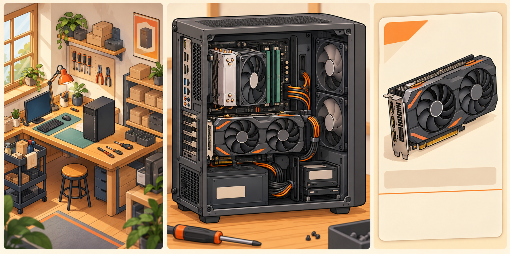

# Demo 详细设计候选

玩家已确认三档难度、普通难度允许合理经营盈利、点选或拖放装配、逐条连接和节点理线，以及干净手绘卡通的暖色工坊画面

以下数值均为本轮游戏设计假设值，覆盖资金、费用、工时、销量、交互阈值和素材尺寸，供首版试玩验证

游戏币与现实货币没有换算关系，Demo 表示 2016 年 1—6 月的试玩版本

配件成本和既有样机配置采用现有配件库 [1]，固定玩法采用游戏规格 [2]

素材保存和切图采用项目约定 [3]，六个月结果由候选经营计算器生成 [4]

## 1 开局资源

三档难度通过现金、场地和人员产生差别，配件兼容、订单承诺和工作台辅助采用同一套规则，困难档仍能经营精品或量产

表 1.1 开局候选，数值由本轮设计提出

| 项目 | 简单 | 普通 | 困难 |
| --- | ---: | ---: | ---: |
| 现金，游戏币 | 24000 | 16000 | 10000 |
| 雇员人数 | 1 | 1 | 0 |
| 装配台数量 | 2 | 1 | 1 |
| 测试台数量 | 1 | 1 | 1 |
| 月租金，游戏币 | 800 | 600 | 450 |
| 月基础杂费，游戏币 | 150 | 150 | 150 |
| 月工资，游戏币 | 1400 | 1400 | 0 |
| 每月固定支出，游戏币 | 2350 | 2150 | 600 |
| 每月可用人工，模拟工时 | 208 | 208 | 96 |

三档开局均无配件库存，玩家自行选择第一套采购

老板每月提供 96 模拟工时，每名基础员工提供 112 模拟工时

每张装配台和测试台各提供 160 模拟工时

模拟工时表示当月可安排的工作量，玩家可以加速执行

界面同时显示人工、装配台和测试台的占用，增加桌子只增加设备容量，增加人员才增加可用人工

普通档固定支出为 $600+150+1400=2150$ 游戏币，困难档起步现金较少且人工减半，固定支出也较低，玩家需要通过小批量交付积累扩张资金

这组资源尚未证明三个难度的完整六个月体验，当前路线比较统一使用普通档，简单档和困难档需要各自的试玩计划

## 2 单台收益

售价减配件、耗材、包装和交付费用得到单台贡献，用于支付月固定支出和发展投入，工资仅在月固定支出中扣除一次

表 2.1 四套样机收益，配件和直接成本来自现有草案 [1]，售价由本轮设计提出

| 方案 | 配件 | 耗材 | 包装 | 交付 | 总直接成本 | 售价 | 单台贡献 |
| --- | ---: | ---: | ---: | ---: | ---: | ---: | ---: |
| 预算办公 | 1750 | 40 | 40 | 40 | 1870 | 2115 | 245 |
| 主流游戏 | 4040 | 60 | 60 | 60 | 4220 | 4566 | 346 |
| 静音办公高定 | 2560 | 180 | 90 | 80 | 2910 | 5100 | 2190 |
| 静音创作高定 | 6440 | 400 | 100 | 100 | 7040 | 11050 | 4010 |

表内四个售价均处于既有预算示例内，直接费用拆分为本轮候选，工具节约仅作用于耗材，包装和交付继续按原值记账

普通档当月交付 1 台静音创作高定和 1 台静音办公高定时，经营利润为 $2460+990-2150=1300$ 游戏币

普通档只销售预算办公机时，$5\times430=2150$ 游戏币恰好覆盖月固定支出，首次开发还有 120 游戏币试制费，因此第一月需要卖出至少 6 台才能盈利

高定预算在订单出现时固定，玩家更换昂贵部件会减少自己的单台贡献，采用工具或复用设计也保持已承诺的订单售价

样机使用的配件继续形成可交付产品，开发费用只覆盖额外试制耗材，报废、返工和退换货需按实际发生的材料损失入账

## 3 工作安排

设计占用老板时间，装配和包装可以分配给老板或员工，测试准备需要人工，持续测试占用测试台，测试过程中人员可以转去其他工作

表 3.1 未升级时单台工时，全部数值为本轮候选

| 方案 | 设计人工 | 装配人工与台位 | 测试准备人工 | 包装人工 | 合计人工 | 测试台占用 |
| --- | ---: | ---: | ---: | ---: | ---: | ---: |
| 定型预算办公 | 0 | 6 | 0.5 | 0.5 | 7 | 2 |
| 定型主流游戏 | 0 | 10 | 0.5 | 0.5 | 11 | 3 |
| 新静音办公高定 | 6 | 10 | 1 | 1 | 18 | 4 |
| 新静音创作高定 | 10 | 14 | 1 | 1 | 26 | 6 |

预算办公首个标准机型增加 12 人工、2 装配台、2 测试台工时和 120 游戏币开发费

主流游戏首个标准机型增加 18 人工、3 装配台、3 测试台工时和 180 游戏币开发费，之后复用保存方案

人工合计与测试台占用分别计算，实际排产按采购到货、装配、测试和交付的先后关系执行

逐项排产还要检查依赖和时间重叠，每月总工时合格仅表示总量可用

局部返工候选为追加 2—4 人工、1—2 测试台工时及 40—100 游戏币耗材，换件返工按新采购、拆装、复测分别计算，卸下的完好配件返回原成本批次

普通采购候选为 8 模拟工时到货，新品首批为 16 模拟工时，整单运费只记一次

商品未上架时不能提前购买，已到货库存按采购批次保留成本

采购前显示预计到货时点和能否赶上交付，临近 Demo 终点的新品可能来不及完成整条工作链

月份内上架日期和具体供应时长需要通过事件排产样例共同确认

首版候选采用 1 秒推进 1 模拟工时，并提供 4 倍、12 倍及完成当前已安排工作入口，工作执行保持当前月份，遇到需要玩家决策的事件暂停

离线只推进已经安排、材料和当月工时均已预留的工作，离线完成与在线执行使用同一工作记录和账目

新的采购、订单接受和月份结算由玩家触发

## 4 六个月路线

六个月候选采用普通档 16000 游戏币、1 名员工、1 张装配台和 1 张测试台，三条路线使用相同工资和需求上限，采购渠道不同

表 4.1 发展投入候选

| 投入 | 一次费用 | 每月新增费用 | 效果 | 适用条件 |
| --- | ---: | ---: | --- | --- |
| 精细工艺工具 | 1200 | 0 | 高定装配工时减少 20%，单台耗材减少 120 | 适用于每次新设计和细致装配 |
| 增加装配台 | 3000 | 0 | 新增 160 台位工时 | 原有员工可继续使用，人工保持原值 |
| 半自动装配设备 | 3000 | 100 | 定型机装配人工和台位工时减少 35% | 需要两张装配台，第二张用于夹具与备料 |
| 新增基础员工 | 600 招募费 | 1400 工资 | 新增 112 人工工时 | 新工资从入职月开始计算 |

精品路线在 3 月投入工艺工具，量产路线在 3 月加台、5 月上半自动设备

混合路线在 3 月投入工具并同时加人，两条产品线需要更早配齐人手，投资月份仅为比较候选，玩家可以改变时机和路线

六个月计划中，精品路线交付的静音办公高定依次为 1、1、1、2、2、2 台，静音创作高定依次为 0、1、1、1、1、2 台

量产路线交付的预算办公依次为 6、8、10、14、18、22 台，主流游戏依次为 1、2、3、5、8、10 台，标准机通过排产制造

混合路线交付的预算办公依次为 4、5、6、7、8、10 台，主流游戏依次为 1、2、2、3、4、5 台，静音办公高定依次为 0、1、1、2、2、2 台，静音创作高定依次为 0、0、1、1、1、1 台

表 4.2 普通档六个月基准结果，由候选计算器生成 [4]

| 结果 | 精品 | 量产 | 混合 |
| --- | ---: | ---: | ---: |
| 生产台数 | 15 | 107 | 69 |
| 售出台数 | 15 | 95 | 69 |
| 经营利润，游戏币 | 32310 | 34420 | 41008 |
| 发展投入，游戏币 | 1200 | 6000 | 1800 |
| 期末现金，游戏币 | 47110 | 13475 | 55208 |
| 期末成品库存成本，游戏币 | 0 | 30945 | 0 |

经营利润已扣月固定支出和开发费，发展投入单独列示

基准情景期末现金等于开局现金加经营利润减发展投入，设备残值和折旧均未计入

三条路线的收益关系符合已确认设计：精品单台利润为 2154 游戏币，约是量产的 6.3 倍，总利润仍低于量产；混合总利润最高，同时低于精品与量产之和 69140 游戏币，差额 25790 游戏币即资源分散的代价

两条压力情景对三条路线的作用不同：客群需求减少 35% 只打击量产，稍多于五分之一的成品转为库存并挤压现金；配件采购价增加 10% 时量产单台利润降到 107 游戏币，混合总利润低于精品。量产路线对需求和成本都最敏感，精品路线最能承受成本上涨，混合路线的优势在需求下滑时最明显

表 4.3 各月期末现金，由候选计算器生成 [4]

| 月份 | 精品 | 量产 | 混合 |
| --- | ---: | ---: | ---: |
| 1 月 | 16040 | 16820 | 15428 |
| 2 月 | 20090 | 19530 | 18355 |
| 3 月 | 23180 | 20830 | 22986 |
| 4 月 | 29780 | 21629 | 32735 |
| 5 月 | 36380 | 16577 | 43365 |
| 6 月 | 47110 | 13475 | 55208 |

3 月量产投资后现金增幅较小，5 月设备降低装配负担，6 月量产占用 182.8 人工和 150.8 装配台工时，仍在 208 人工、320 台位工时范围内

精品工具从 3—6 月的 12 台高定中节约 $12\times120=1440$ 游戏币耗材，高于 1200 游戏币设备费，同时减少装配工时，价格和客户要求保持原订单承诺

精品路线 6 月人工占用为 78.4 工时，客群上限始终高于产量，瓶颈是玩家能完成多少高定；量产路线 6 月接近人工容量，同时产量超过客群上限，期末压住 30945 游戏币成品库存

### 4.1 采购渠道作为路线差异

三条路线共用 [供应商经营草案](supplier-system.md) 的三档渠道，差别只在能走到哪一档，渠道单价系数直接取自该草案，不再单独维护一份

| 路线 | 每月同款配件用量 | 可达渠道 | 渠道单价系数 | 单台利润，游戏币 |
| --- | ---: | --- | ---: | ---: |
| 精品 | 1—2 台 | 现货零购 | 100% | 2154 |
| 混合 | 约 7 台办公机 | 经销批采 | 95% | 594 |
| 量产 | 18—22 台 | 预约批次 | 90% | 362 |

渠道选择是当前最大的单项经济杠杆。量产路线若改用零购价采购，利润从 34420 降到 12299，混合路线从 41008 降到 30442，所以低售价的量产路线只有走到批量档才能与市场售价竞争，这一点与现实中大厂依靠采购规模维持薄毛利一致

这条规则同时给出混合模式"资源分散代价"的具体来源：混合路线两条产品线各约 5—10 台，任何一条都够不到预约批次的 20 件起订，只能停在经销批采档，比量产路线每台多付 5% 的配件成本

## 5 销售反馈

标准机需求由公司可触达客群、用途适配、售价、口碑和能否按期供货共同形成，原型建议先显示一个范围，再根据真实销售反馈修正

候选标准机成交量为 $\min(\text{可交付数量},\lfloor D\times F\times P\times R\rfloor)$，其中 $D$ 为公司当月客群上限，$F$ 为用途适配，$P$ 为价格接受程度，$R$ 为口碑系数

价格接受候选为 $\operatorname{clamp}((\text{市场参考价}/\text{售价})^2,0.5,1.3)$，公司客群规模提供上限，降低售价可以吸引客群但会压低单台贡献

首轮计算将用途、价格和口碑系数都固定为 1，使用设计给定的月客群上限和生产计划

自然增长、实际市场预测和完整成交曲线需要通过实际订单验证

公司月客群上限候选：预算办公为 6、8、10、13、16、18 台，主流游戏为 2、2、3、4、6、8 台，静音办公高定为 2、3、4、5、6、6 单，静音创作高定为 1、2、2、3、3、4 单

量产客群上限合计 96 台，低于量产路线的计划产量 107 台，超出部分转为成品库存，这是量产卖不完的来源；高定客群上限合计 41 单，高于精品路线的产量 15 单，精品卖得掉但做不过来。量产收益由客群规模决定，精品收益由玩家能完成的高定量决定

高定先接受有固定预算的订单再生产，标准机可能先生产后销售，成品未售出时资金留在库存中，利润表和现金表必须分别显示

表 5.1 压力情景期末结果，由候选计算器生成 [4]

| 情景 | 精品现金 | 量产现金 | 混合现金 | 主要后果 |
| --- | ---: | ---: | ---: | --- |
| 客群需求减少 35% | 47110 | 445 | 50642 | 量产压住 25425 游戏币成品库存，6 月采购受限 |
| 配件采购价增加 10% | 40942 | 3184 | 37641 | 原售价保持，量产单台利润降到 153 游戏币 |

需求减少情景保留原标准机生产计划，高定只接受实际出现的订单

玩家主动缩减排产可以改善现金，计算器保留原计划用于展示过量生产后果

混合路线目标销量在这组客群减少情景中仍低于各细分客群上限，所以结果未下降

计算器缺少跨产品的客群竞争、老板切换工作和口碑变化，这个结果不能证明混合路线天然更稳

当前九组情景检查每月总人工、老板设计工时、装配台、测试台及现金收支守恒

采购先付款，交付后收入才能用于下一台，不允许同一台收入预先支付自己的成本

月总量校验没有检查逐项工作的依赖与时间重叠，当前结果用于评审投入比例

到货、新品日期、返工、真实成交及两个其他难度仍需纳入排产和试玩

## 6 工作台操作

玩家已选择点选或拖放、逐条连接和固定节点理线，自动辅助随时可用，保存方案包含完整安装位、模块、颜色、灯效、线缆路径及测试设置

工作台候选采用侧面装配、背板理线和外观展示三个固定视图，切换时保留所选部件

外观展示使用四分之三角度，其他视图优先让接口和合法位置清楚可见

表 6.1 交互候选，距离单位为屏幕逻辑像素

| 操作 | 候选反馈 |
| --- | --- |
| 点击部件卡片 | 高亮合法安装位，点击位置也能完成装配 |
| 拖动部件 | 半透明预览，松手后吸附到合法安装位 |
| 非法放置 | 恢复原位，显示冲突对象与可行修改入口 |
| 选择接口 | 同时突出可匹配端口，端口名称与接头类型并列 |
| 接线 | 选择起点、终点，再逐个选择相邻理线节点 |
| 调整理线 | 拖动经过点到相邻合法节点，实时显示长度与通道占用 |
| 遮挡部件 | 选中后降低遮挡层透明度，显示被挡接口的引出标签 |
| 视图移动 | 空白处单指平移，双指缩放，缩放候选为 1—2.5 倍 |
| 问题定位 | 点击问题后切到对应视图，高亮部件、线段或通道 |
| 侧板闭合 | 播放短闭合预览，冲突处高亮并显示挤占空间 |

部件选择后的拖动才表示装配，空白处拖动表示移动视图，最小触控区域候选为 48×48

接口的放大触控区域不改变接口真实尺寸，密集接口通过候选列表选择

吸附候选距离为 20 逻辑像素，附近多个位置同时可用时显示位置选项，图形吸附和兼容检查分别执行，玩家可以用点选替代精细拖动

拆除电源会卸下关联电源线，拆除主板会连带取下板载部件及所连线缆

拆除硬盘架会同时取下架上的硬盘，影响列表在确认条内显示，操作后可整体撤销

编辑中的一次部件移动、节点更换或关联拆除作为一个撤销动作，候选保留最近 20 步

撤销只作用于未提交的设计编辑，已经执行的采购和生产账目保持实际记录

自动安装只处理合法位置，辅助接线只补缺少的必需连接，辅助理线给出合格基础路径，玩家可以继续修改，辅助使用本身不扣评价分

辅助使用原库存线材，遇到接头不足、线路过长或不存在合法路径时说明缺少条件，辅助与手工方案通过同一套交付检查

## 7 机箱设计

每个机箱使用自己的局部毫米坐标和通道，已有节点名称表示功能，节点坐标、相邻关系、通道容量和面板净空分别绑定各机箱

mm 表示毫米，前侧与背侧节点只能通过定义好的过线孔连接

线缆总长按相邻通道长度相加，每个端头增加 20mm 弯折余量，长度不足会阻止闭合或交付

表 7.1 理线几何初值，全部为待几何验证的原创机箱设计

| 机箱 | 背板理线净空候选 | 主通道容量候选 | 交互重点 |
| --- | ---: | ---: | --- |
| 小匣 M | 18mm | 4 格 | 短路径和紧凑空间 |
| 构序 A | 22mm | 6 格 | 展示侧整齐与维护空间 |
| 静室 S | 25mm | 5 格 | 硬盘架取舍与隐藏线束 |

通道容量的格表示游戏线束占用，数据线和风扇线各占 1 格

处理器与显卡供电线各占 2 格，主板主供电线占 3 格

容量达标后仍需检查实际线束厚度和侧板净空

首版电源随附线长候选如下，主板、处理器、显卡和储存支线保持相同列举顺序：

- 航海 350：450、450、400、450mm
- 航海 450：500、550、450、500mm
- 航海 650M：550、650、550、600mm

上述线长属于游戏供货包候选，任何线路仍由独立接头类型和数量约束

处理器供电头与显卡供电头不能互换，固定式电源未用线也要进入固定收纳位置

侧板、风扇叶片旋转空间、散热器、显卡供电弯折空间和维护通道各有检查体积

图片可以显示深度，交付检查以逻辑空间为准，通道初值通过后还需装配原型验证

表 7.2 定制候选，选项保持在固定 32 个配件条目之外

| 选项 | 追加游戏币 | 追加加工人工 | 影响 |
| --- | ---: | ---: | --- |
| 原厂颜色与面板 | 0 | 0 | 采用当前机箱基准值 |
| 机身换色 | 40 | 2 | 改变配色与客户风格适配 |
| 通风前面板 | 50 | 2 | 候选增加 20 散热单位，噪声负担乘 1.10 |
| 透明侧板 | 80 | 2 | 展示内部，候选噪声负担乘 1.05 |
| 玩家品牌铭牌 | 20 | 1 | 固定可放位置与尺寸，不占散热口 |
| 装饰线材外皮 | 60 | 1 | 改变颜色，接头和线长保持原供货包 |
| 单色灯带 | 30 | 1 | 固定位置，候选额外计 2W 游戏负载 |
| 追加机箱风扇 | 30 | 1 | 采用现有风扇散热、负载和噪声初值 |

表内定制费用在方案中按选项累加，经济样机表已有高定耗材预算

实施时将实际选项费用替换对应预算项，避免同一外观工艺重复收费

面板影响相对于该机箱默认面板计算，静室 S 默认降噪效果已在当前基准中，安装同款默认面板不再加一次降噪收益

客户外观评价候选由风格适配 30%、配色适配 25%、展示面理线 25% 和细节完成度 20% 组成，每项显示扣分原因，华丽与简洁按客户偏好判断

硬件兼容、客户硬性要求、侧板闭合和压力测试必须全部通过，再计算偏好评价，外观高分保持与用途能力分开显示

## 8 美术制作

用户已选择干净手绘卡通、暖色工坊和清楚硬件细节，候选实现为工坊分层图片与固定视图工作台

装配规则使用独立空间数据，视图之间由同一设计映射

图 8.1 内置图片生成工具绘制的画风候选，生成要求保存于 [提示词记录](../art/prompts/style_review_v01.json)

评审图采用暖木、奶油色背景、深灰硬件和橙色点缀，机箱图的细节密度较高，正式部件需要降低纹理密度并按固定视图重画

工坊等距镜头、部件安装方向和接口位置按制作基准校正，评审图提供配色与材质方向，完整装配几何由工作台数据确定

工坊可采用等距平行投影，水平转角候选为 45°，俯角为 35.264°，所有工坊设备共用镜头，手绘部件保持固定比例，角色可轻度夸张

固定视图能够使生成图片、切图和接口点击采用同一组基准

任意旋转机箱需要每种部件具有完整三维模型，因此会增加模型和贴图制作工作

表 8.1 画面候选

| 项目 | 候选规则 |
| --- | --- |
| 主色 | 奶油背景、暖木、橙色点缀，机箱用冷灰和少量蓝绿色 |
| 线条 | 深灰轮廓，外轮廓粗于内部细节，接口轮廓清楚 |
| 材质 | 哑光金属、塑料、木材和柔和玻璃反射，避免密集写实纹理 |
| 光照 | 左上柔光，统一右下落影，接触阴影单独制作 |
| 硬件比例 | 板型、卡长和散热器高度保留逻辑比例，端口可加引出标签 |
| 正文字体 | 清楚的中文无衬线，常用正文 16—18 逻辑像素 |
| 标题字体 | 同一字体加粗，标题 22—28 逻辑像素 |
| 信息色 | 通过、提示和错误同时配文字与形状，颜色辅助辨认 |
| 品牌 | 采购、包装与贴纸用正式品牌，玩家标识放机身指定位置 |
| 幽默 | 新闻、员工对话和反馈用硬件圈笑点，规格信息保持清楚 |

正式品牌、系列和型号由文字层或独立标识层组合，生成图片预留空白贴纸区

采购显卡继续分别显示板卡制造商、图形平台、产品系列和物理版本

表 8.2 画布与导出候选，像素值属于首版制作目标

| 对象 | 逻辑展示基准 | 原图与导出 |
| --- | --- | --- |
| 竖屏界面 | 390×844 | 按安全区和屏幕长宽比重排 |
| 工坊完整画面 | 390×540 可视区域 | 1560×2160 原图，780×1080 基础导出 |
| 工坊独立设备 | 按格对齐 | 常用导出 256×256 或 512×512 |
| 工作台单视图 | 约 340×480 | 1024×1536 对齐原图，关键部件独立透明图 |
| 配件采购卡 | 358×156 | 部件图常用 256×256 或 512×512 |
| 界面图标 | 24—32 可视尺寸 | 64×64 导出，点击区域至少 48×48 |
| 可伸缩按钮与面板 | 按内容宽高 | 独立边角切片，文字由引擎显示 |

工作台每种机箱保留共同视图原点和像素到毫米映射，零件图片按自身尺寸缩放到逻辑位置

同一尺寸的部件在同一视图中保持相同比例

每个机箱原图拆分底壳、托盘、前面板、侧板、上盖、可拆硬盘架、风扇、阴影和遮挡层

板卡、散热器和电源分别生成完整独立图片，整幅成图切片不能恢复被遮挡的部件

线缆由程序按节点绘制曲线，独立素材只提供插头、固定件和少量表面纹理

长度、走向和遮挡采用同一设计数据，避免固定图片与理线结果脱节

ms 表示毫秒，风扇采用叶片层旋转

按钮按下和装配吸附动画候选为 150—220ms，工作台视图切换为 180ms

角色先制作待机、装配和搬箱三种动作，各动作候选 4—6 帧

大幅工坊背景单独保存，小型图集按通用界面、工坊设备、配件卡片和单机箱工作台划分

候选单图集上限为 2048×2048，实际内存和包体需通过浏览器、微信工具和真机分别测量

切片名候选如 `case_grid_front_shell_v01`、`gpu_970_side_v01` 和 `workshop_bench_idle_v01`，相同对象替换原位时保留已有 Cocos `.meta` 文件中的资源引用标识

原图进入 `art/source`，提示词进入 `art/prompts`，Figma 切片记录进入 `art/figma`，通过确认的导出才进入 `assets/art`，视觉候选图不直接作为可装配素材

## 9 评审重点

三项已确认偏好采用正式规格执行，当前候选中最影响首版体验的是开局现金与固定费用、辅助交付规则，以及固定视图的图片实现

普通档三条路线都在九组情景中完成月总量和账目计算，量产压货能够产生可见的现金后果

混合路线的客群竞争和精品设计差异仍需要真实订单与试玩反馈

首个可玩样例应包含一套主流游戏机和一套静音办公高定

样例检查采购、拖放、逐条连接、节点理线、侧板闭合、测试、保存复制与交付，合格后再用相同规则覆盖全部配件

工作台几何由逐机箱坐标、通道和检查体积决定，美术图只能支持观察

排产正确性由依赖和账目记录决定，月总量计算仅提供投入比例的初步依据

## 10 参考依据

[1] [Demo 配件库草案](components-draft.md)与 [样机数值](../design/balance.json)，提供配件成本、直接费用、配置及用途评分

[2] [游戏规格](spec.md)，提供已确认玩法、范围与本轮用户偏好

[3] [素材制作约定](art-workflow.md)，提供原图、提示词、Figma 切图和运行素材的保存流程

[4] [经营候选参数](../design/economy-candidate.json)与 [六个月计算结果](../design/economy-review-results.json)，由 [候选计算器](../tools/simulate-economy.cjs)生成九组情景，用于复核人工、设备与现金
